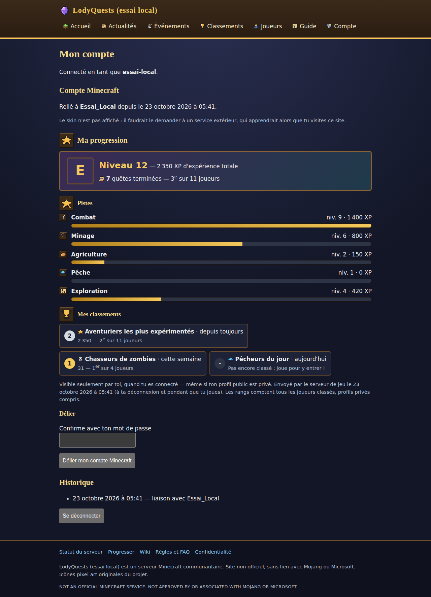
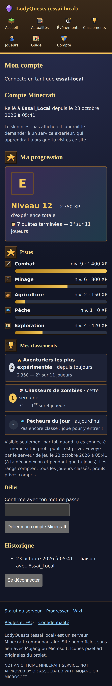
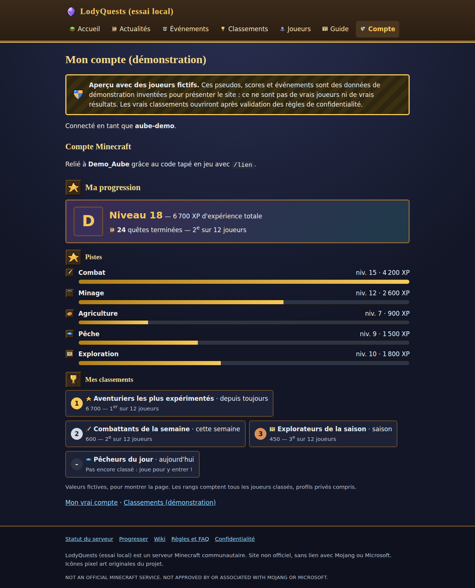

# RPGQuest — Rapport Claude

## Informations

* Date : 2026-10-23
* Heure : 06:18
* Sujet : #53 lot 6 WebPortal — progression personnelle du joueur relié (compte web ↔ UUID Minecraft)
* Statut : DONE (livré, déployé, vérifié techniquement ; validation en jeu PENDING MANUAL VALIDATION)
* Branche Git : `feature/53-progression-liee` → fusionnée dans `chore/257-ci-github-actions` (PR #769, merge `2c3b5bbf`) ; rapport : `docs/53-rapport-progression-liee`
* Commit actuel si disponible : `2c3b5bbf` (code), commits `3a2ff1b4` (plugin), `90b61270` (portail), docs ensuite
* Début de la tâche : 2026-10-23 05:28:22
* Fin de la tâche : 2026-10-23 06:19:19
* Durée totale : 00:50:57

## Demande

Session lqorch #53, mission WebPortal du 22/10 (spec `2026-10-22-webportal-relance.md`, PRIORITÉ 6) :
liaison sécurisée compte Web ↔ UUID Minecraft avec preuve faite en jeu (déjà livrée en V1 le 15/10,
désactivée), et **le portail doit pouvoir afficher la progression, les statistiques et les classements
personnels autorisés**. Communication réelle, authentifiée et testable en environnement isolé ;
AUCUNE liaison réelle, aucune activation de `accounts-enabled` sur DEV, aucun changement de
`web-export.enabled` / `player-data-public`, aucune donnée individuelle réelle publiée ou ingérée.

## Analyse

État réel vérifié : V1 #53 (`e363a03`) en place — `/lien` (plugin), `/api/link/confirm` (jeton dédié),
`accounts.db` V1, `/compte` « pas encore ouverts » ; DEV : `portal-link.properties` non activé.
Rien ne transportait la progression d'un joueur relié vers le portail : le seul flux joueur était
l'instantané public (#421), qui ne porte ni UUID ni données des profils privés, et qui reste
désactivé (`web-export`).

Choix structurants (réversibles, dans l'architecture existante) :

1. **Même sens que #421** : le serveur Minecraft pousse, AWS reçoit (VeryGames n'accepte aucune
   connexion entrante) ; même jeton que `/lien` (`RPGQUEST_PORTAL_LINK_TOKEN`), nouvelle route exacte.
2. **Aucune statistique d'un joueur non relié ne quitte le serveur** : sonde `{"uuid"}` seule tant
   que l'état est inconnu ; `NOT_LINKED` retenu jusqu'au redémarrage ; `/lien` accepté le remplace.
3. **Espace privé, pas une publication** : visible du seul titulaire connecté, même si son profil
   public est privé ; jamais dans l'instantané ni une API publique ; effacé avec la liaison.
4. **Rang personnel** compté parmi tous les joueurs classés (profils privés compris, exclus de
   modération non) : ne révèle qu'un nombre. Un joueur exclu d'un classement n'y a pas de place.
5. Réutilisation : mêmes fenêtres/filtres/raisons d'XP ignorées que les classements publics
   (`StatBoard.current/periodFor`, `windowFilter`, archives `stat_period_results`).

## Travail effectué

**Plugin**
- `StatisticsRepository.Standing` + `liveStanding` / `archivedStanding` (CTE : valeur, rang
  « compétition », effectif) ; `QuestStatisticsRepository.standing`.
- `web.link.LinkedProgressBuilder` : XP + niveau par piste (courbe du `ProgressionService`), quêtes,
  place sur chaque classement **publié** (100 max), hors thread principal.
- `web.link.LinkedProgressPublisher` (service + listener) : envoi après `/lien` LINKED, à la
  déconnexion, toutes les `progress-interval-minutes` (défaut 15, 0 = pas de périodique) ; un envoi
  en vol par joueur ; erreurs → `UNAVAILABLE` sans verrou bloqué.
- `PortalLinkClient.pushProgress` + `ProgressReply` ; `LinkCommand.onLinked` ; `PortalLinkConfig`
  (`progressIntervalMinutes`) ; câblage `RPGQuestBootstrap` (inerte si la liaison est désactivée).

**Portail (web-api)**
- `POST /api/link/progress` (`LinkProgressHandler`) : sonde → `LINKED|NOT_LINKED` ; envoi →
  `STORED|NOT_LINKED|THROTTLED` ; 401 sans jeton dédié, 503 comptes fermés, 400 hors contrat, 64 Kio.
- `LinkedProgress` : liste blanche stricte (champs bornés, motifs, rang ≤ effectif, 100 classements).
- `AccountStore` V2 : table `linked_progress` (FK `minecraft_links` ON DELETE CASCADE) ; anti-rejeu
  (`generatedAt` croissant, date future ramenée à maintenant), 30 s entre deux écritures.
- `/compte` : « Ma progression » (niveau global, pistes, quêtes avec rang, « Mes classements » avec
  podium / « pas encore classé ») ; message d'attente avant le premier envoi.
- `/demo/compte` : aperçu fictif `Demo_Aube` (bandeau, `noindex`, aucun formulaire).
- nginx : `location = /api/link/progress` (POST seul, même limite que `/api/link/confirm`).

Captures (données **fictives** : instance locale jetable, compte `essai-local`, UUID inventé) :

## Fichiers créés

- `src/main/java/com/lodygames/rpgquest/web/link/LinkedProgressBuilder.java`, `LinkedProgressPublisher.java`, `ProgressReply.java`
- `src/test/java/com/lodygames/rpgquest/web/link/LinkedProgressBuilderTest.java`, `LinkedProgressPublisherTest.java`
- `web-api/src/main/java/com/lodygames/rpgquest/webapi/account/LinkedProgress.java`, `LinkedProgressView.java`, `LinkProgressHandler.java`
- `web-api/src/main/java/com/lodygames/rpgquest/webapi/site/DemoAccountPageHandler.java`
- `web-api/src/test/java/com/lodygames/rpgquest/webapi/account/LinkedProgressTest.java`

## Fichiers modifiés

- Plugin : `StatisticsRepository`, `QuestStatisticsRepository`, `PortalLinkClient`, `PortalLinkConfig`,
  `PortalLinkConfigLoader`, `LinkCommand`, `RPGQuestBootstrap` ; tests `StatisticsRepositoryTest`,
  `PortalLinkClientTest`, `PortalLinkConfigLoaderTest`.
- Portail : `AccountStore`, `AccountService`, `AccountPagesHandler`, `LinkConfirmHandler` (motif de
  pseudo partagé), `HttpServerBootstrap`, `DemoData` ; test `AccountHttpTest`.
- `scripts/web-portal/nginx-lodyquests-portal.conf`, `scripts/portal-link.properties.example`.
- Docs (voir plus bas).

## Base de données / migrations

- `data.db` (jeu) : **aucune** migration, lecture seule.
- `accounts.db` (portail) : V2 `linked_progress` (idempotente, `CREATE TABLE IF NOT EXISTS`) ; créée
  seulement quand les comptes sont activés — sur AWS, la base n'existe pas aujourd'hui.

## Configuration / données

- Nouvelle clé **facultative** `progress-interval-minutes` (portal-link.properties). Rien à changer
  sur DEV : liaison toujours désactivée, donc aucun envoi.
- `accounts-enabled`, `web-export.enabled`, `player-data-public` : **inchangés**.

## Tests automatiques

- Plugin ciblé : `web.link.*` + `StatisticsRepositoryTest` → 32 tests, 0 échec (local).
- `:web-api:test` complet → 161 tests, 0 échec (local).
- CI PR #769 : verte (tous jobs). CI du merge `2c3b5bbf` : 1er passage rouge sur
  `WaypointServiceTest > firstDiscoveryShowsTheCanonicalNameNotOnlyTheBiome()` (assertion l. 593) —
  sans lien avec ce lot, vert en relance locale ciblée (32/32) ; relance du job échoué → **verte**
  (run 39897152107). Test fragile probable : `performTicks(5)` après une écriture asynchrone.
- Parcours isolé de bout en bout (instance locale jetable, comptes ouverts, compte et UUID fictifs) :
  sonde `NOT_LINKED` → preuve `LINKED` → sonde `LINKED` → envoi `STORED` ; rendu 1280 et 390 px sans
  défilement horizontal (Playwright Chromium). Instance arrêtée, base jetable.

## Tests manuels à effectuer

**TC-417** (docs/MANUAL_TEST_PLAN.md) — PENDING MANUAL VALIDATION :
- A (maintenant) : https://lodyquests.lodylands.com/demo/compte (ordinateur + téléphone) ;
  `/compte` toujours « pas encore ouverts ».
- B (après ouverture des comptes, TC-326 B) : progression après `/lien`, à jour après déconnexion,
  visible avec `/profile web prive`, disparue après « Délier », jamais visible d'un autre compte.
Aucun test en jeu n'a été fait par Claude.

## Résultat attendu

Joueur relié → `/compte` montre sa progression réelle, mise à jour à chaque déconnexion et toutes les
15 min ; joueur non relié → aucune donnée envoyée hors du serveur de jeu.

## Reset / retour à l'état initial

« Délier » sur `/compte` efface la progression stockée. Désactiver `portal-link.properties` arrête
tout envoi. Aucune donnée de jeu modifiée.

## Déploiement VeryGames

- JAR `2c3b5bbf` (CI verte), SHA-256 `fe68623f727b32c78782fbcff1b3fbb12202f2b640047633321b9e39440d141c`,
  **retéléchargé par FTP : identique**, classes `LinkedProgress*` présentes.
- Backup préalable : `~/.local/share/rpgquest/verygames-backups/rpgquest-20261023T041648Z-predeploy.jar`
  (SHA-256 `d4317119…`, = JAR #735).
- Redémarrage RCON (`verygames-restart.sh`) à 0 joueur connecté, serveur revenu ONLINE.
- À NE PAS altérer : `data.db`, `config.yml`, `portal-link.properties` (absent / désactivé — liaison
  réelle non autorisée). Aucune migration côté jeu.

Portail AWS : `scripts/web-portal/deploy.sh` (sauvegarde `/opt/lodyquests-portal/releases/20261023-061623`),
`/health` UP. nginx : vhost Certbot sauvegardé
(`/home/ubuntu/backups/nginx/lodyquests-portal.20261023-055045`), **seul** le bloc
`/api/link/progress` inséré, `nginx -t` OK, rechargé.

URLs réellement vérifiées (public, après déploiement) : `/demo/compte` 200 (bandeau « joueurs
fictifs », `noindex`, « Ma progression », `Demo_Aube`) ; `/compte` 200 « pas encore ouverts » ;
`/`, `/classements` 200 ; `POST /api/link/progress` 401, `GET` 403 ; `POST /api/link/confirm` 401 ;
`/api/status` 404 ; journal du service : `comptes=désactivés`. JAR déployé contient
`LinkProgressHandler`, `DemoAccountPageHandler`, `LinkedProgressView`.

## Rollback

- JAR : remettre le backup `rpgquest-20261023T041648Z-predeploy.jar` (`--also` non requis) + RCON.
- Portail : `scripts/web-portal/rollback.sh` (release `20261023-061623`).
- nginx : recopier le vhost sauvegardé, `nginx -t`, reload.
- `linked_progress` peut rester (ignorée par l'ancienne version).

## Logs / diagnostic

- Plugin : `Progression portail non envoyée pour <pseudo> : …` (warn) en cas d'échec ; jamais le contenu.
- Portail : réponses `result` ; le contenu n'est jamais journalisé.
- Journaux de déploiement : `/home/ubuntu/backups/deploy-verygames-53-*.log`, `portal-deploy-53-*.log`.

## Documentation mise à jour

`docs/WEB_PORTAL.md` §2 (progression, sécurité, mise en route nginx), `docs/WEB_API.md`,
`docs/PRIVACY.md` §2.2 / §4, `docs/RPGQUEST_BIBLE.md` (`/lien`), `docs/deployment/WEB_PORTAL_AWS.md`,
`docs/current_state.md`, `docs/deployment/SERVER_CHANGELOG.md`, `docs/MANUAL_TEST_PLAN.md` (TC-417),
`docs/SUIVI_VALIDATIONS_DEV.md` (ligne 15h, dans la PR de ce rapport).

## Limitations / travail restant

- **Décisions propriétaire** (inchangées, #55) : ouverture des comptes (seuils d'âge, `accounts-enabled`,
  jeton des deux côtés), puis TC-326 B et TC-417 B. Proposition : ouvrir d'abord pour le seul compte
  propriétaire sur DEV pour la recette, sans communication publique.
- Avant ouverture publique : export et suppression de compte (l'export doit inclure la progression),
  changement de mot de passe, consentement parental, durée du journal des liaisons.
- La progression ne contient pas encore stories, succès, distance ni temps de jeu (mesures non suivies,
  `StatMetric.PLANNED`) ; elle suivra le catalogue sans changement de contrat (classements).
- Test fragile `WaypointServiceTest.firstDiscoveryShowsTheCanonicalNameNotOnlyTheBiome` (hors périmètre).

## Prochaine étape suggérée

Export / suppression de compte et changement de mot de passe (prérequis d'ouverture publique), puis
ouverture contrôlée des comptes sur décision propriétaire.
