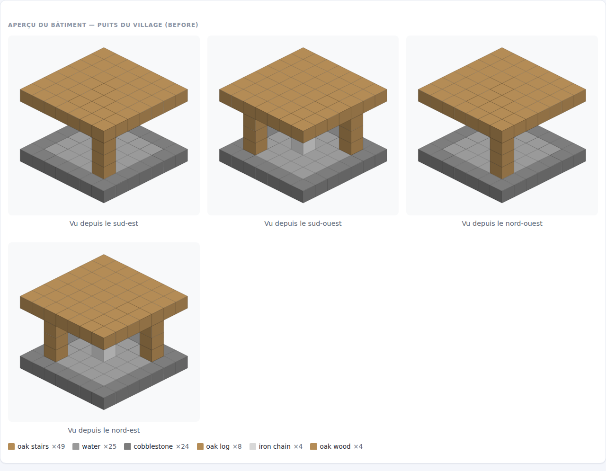
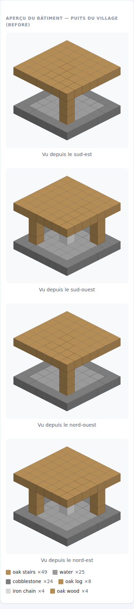
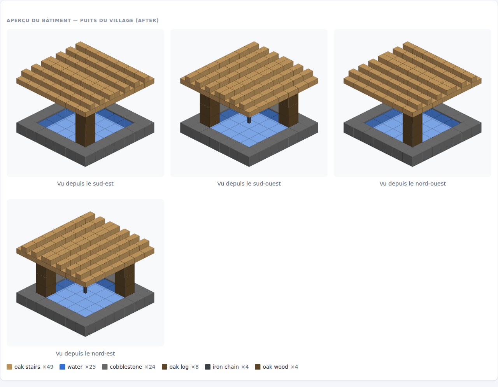
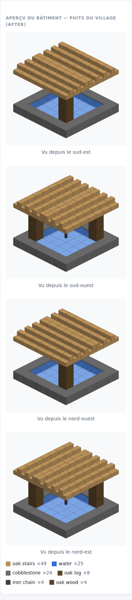
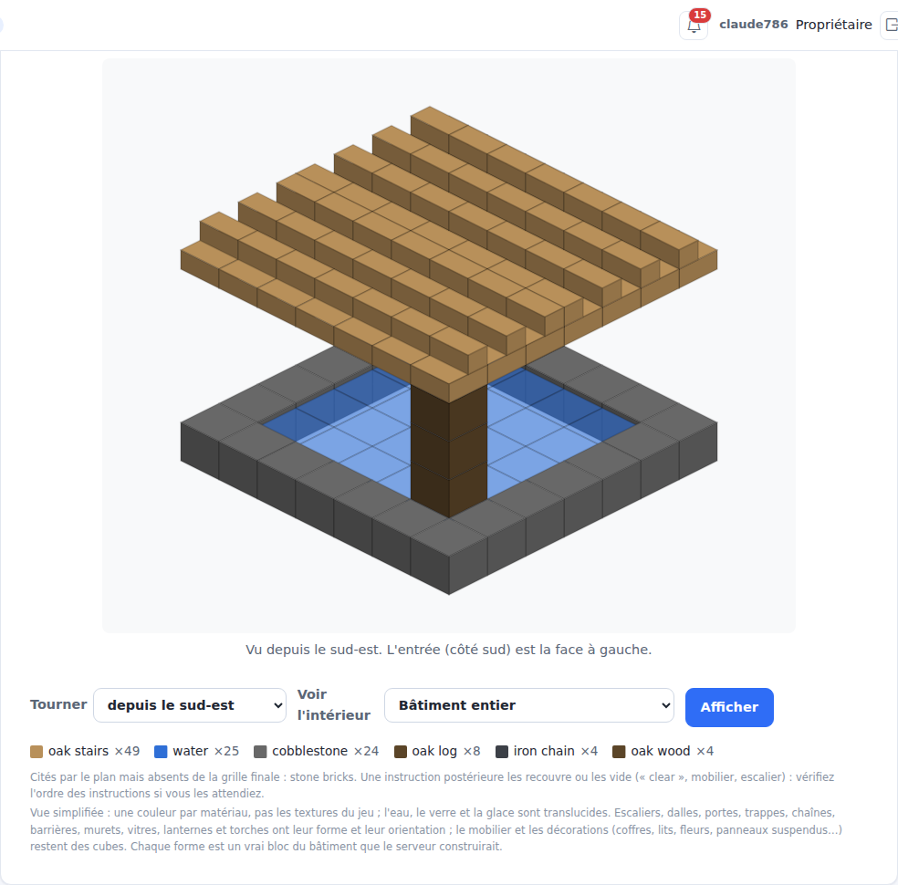
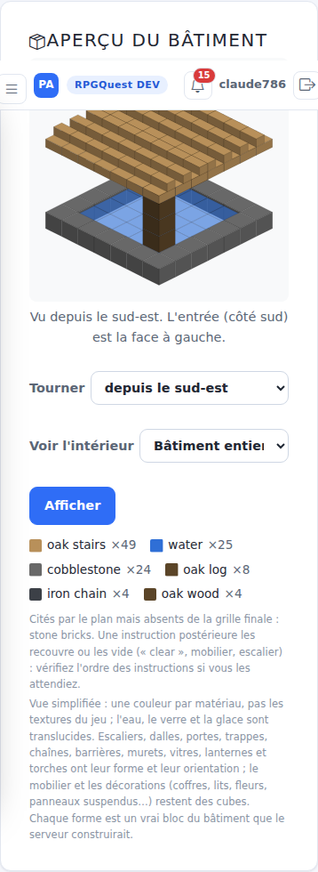
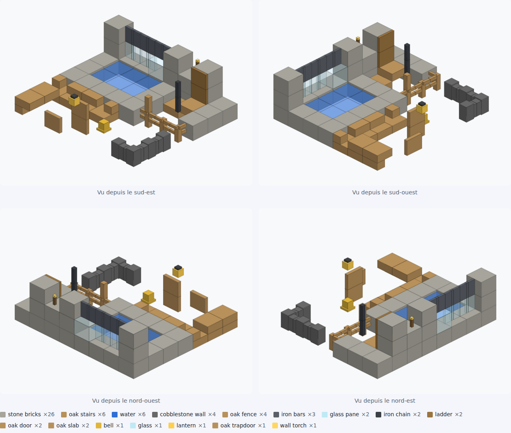

# RPGQuest — Rapport Claude

## Informations
* Date : 2026-10-23
* Heure : 21:55
* Sujet : #786 — aperçu 3D des bâtiments plus fidèle (eau et verre translucides, marches et dalles selon leurs états, blocs fins, orientations)
* Statut : DONE (livré, déployé sur DEV ; validation visuelle du propriétaire en attente — PENDING MANUAL VALIDATION)
* Branche Git : `feature/786-apercu-fidele` (PR #804, fusionnée dans `chore/257-ci-github-actions` = `c42c6bf0`) ; rapport : `docs/786-rapport-apercu`
* Commit actuel si disponible : `c42c6bf0` (déployé)
* Début de la tâche : 2026-10-23 21:09:47
* Fin de la tâche : 2026-10-23 21:56:11
* Durée totale : 00:46:24

## Demande
Issue #786 (P3, suite de #273, EPIC #94) : le puits généré est réussi en jeu, mais l'aperçu PlugAdmin le
montrait comme « une dalle en pierre surmontée d'un plateau en bois » : eau grise opaque, escaliers en
cubes pleins, chaîne massive, matériaux de couleurs trop proches. Corriger le **moteur d'aperçu** à
partir des blocs compilés et de leurs états, sans image générée par IA ni appel payant ; vérifier sur le
puits existant sans modifier sa construction, son projet ni ses versions.

## Analyse
- Le rendu est fait par PlugAdmin (`IsometricView`, SVG côté serveur), mais à partir de la grille que le
  plugin calcule (`PlanPreview.voxels`). Cette grille ne transportait que le matériau, le rôle et la
  moitié des dalles : **aucune orientation**. Il fallait donc modifier **les deux** (JAR + PlugAdmin).
- Sur le puits réel (plan v1 relu en lecture seule dans la base PlugAdmin) : `water` n'avait aucune
  couleur propre (gris par défaut `#9a9a9a`), `cobblestone` `#7d7d7d` et `stone_bricks` `#7f7f7f`
  presque identiques, `oak_log`/`oak_wood` prenaient la couleur des planches (le mot « oak » gagnait),
  `iron_chain` un cube gris clair, les 49 `oak_stairs` des cubes pleins.
- Le toit `gable` du puits compile en **une seule couche** de marches (rangées nord tournées vers le sud,
  rangées sud vers le nord) : l'aperçu fidèle le montre désormais tel quel — c'est la vérité du plan, pas
  un défaut du rendu.

## Travail effectué
**Plugin** (`PlanPreview`, `BukkitAgentActions`)
- `PaletteEntry.state` : propriétés qui changent le dessin, triées (`facing`, `half`, `shape`, `axis`,
  `hanging`, `attachment`, `hinge`, `open`, `face`). Connexions de barrières/vitres, `waterlogged`, niveau
  d'eau, redstone exclus (le panel recalcule les connexions depuis les voisins, comme le jeu).
- Palette étendue à 90 symboles (ponctuation sans `"`, `\` ni `.`). Au-delà de 90 variantes d'état :
  **repli** sur une entrée par matériau, sans états (la vue reste au lieu de disparaître).
- Champ `state` ajouté au JSON de `building.plan.preview` (additif, compatible dans les deux sens).

**PlugAdmin**
- Nouveau `BlockShapes` : chaque bloc = liste de pavés en coordonnées du monde. Marches (demi-dalle +
  contremarche ; droite, coins intérieur/extérieur gauche/droite ; retournées), dalles, eau (surface
  abaissée), vitres et barreaux, barrières, murets (reliés aux voisins), portillons, chaînes (axe),
  lanternes posées/suspendues, torches (murales décalées vers leur mur), cloches, portes (fermées /
  ouvertes selon la charnière), trappes, échelles, panneaux, tapis, plaques de pression.
- `IsometricView` : dessine les pavés tournés avec la vue ; une face n'est masquée que par un voisin
  **plein et opaque** (ou le même bloc plein, ou de l'eau contre de l'eau) ; eau (`.62`), verre (`.35`),
  verre teinté (`.55`), glace translucides ; table `SPECIFIC` (eau, lave, verre, glace, chaîne, barreaux,
  lanterne, cloche, pierre moussue, pavé, briques de pierre…) et écorce des troncs distincte des
  planches.
- Note sous la légende mise à jour : ne cite plus que les simplifications restantes.
- `docs/RPGQUEST_BIBLE.md` (section « Aperçu du bâtiment en 3D ») mise à jour.

## Fichiers créés
- `control-panel/src/main/java/com/lodygames/rpgquest/panel/building/BlockShapes.java`
- `control-panel/src/test/java/com/lodygames/rpgquest/panel/building/BlockShapesTest.java`
- `docs/claude-reports/assets/786-apercu/*.png` (avant/après, DEV, échantillon)
- ce rapport

## Fichiers modifiés
- `src/main/java/com/lodygames/rpgquest/building/plan/PlanPreview.java`
- `src/main/java/com/lodygames/rpgquest/web/agent/BukkitAgentActions.java`
- `src/test/java/com/lodygames/rpgquest/building/plan/PlanPreviewVoxelsTest.java`
- `control-panel/src/main/java/com/lodygames/rpgquest/panel/building/BuildingVoxels.java`
- `control-panel/src/main/java/com/lodygames/rpgquest/panel/building/IsometricView.java`
- `control-panel/src/main/java/com/lodygames/rpgquest/panel/web/WorkshopPages.java`
- `control-panel/src/test/java/com/lodygames/rpgquest/panel/building/IsometricViewTest.java`
- `docs/RPGQUEST_BIBLE.md`, `docs/MANUAL_TEST_PLAN.md` (TC-425), `docs/deployment/SERVER_CHANGELOG.md`,
  `docs/SUIVI_VALIDATIONS_DEV.md`, `docs/claude-reports/README.md`

## Base de données / migrations
Aucune migration. Aucune donnée de construction ni de joueur modifiée.

## Configuration / données
Aucune configuration modifiée.

## Tests automatiques
- Ciblés en local : `BlockShapesTest` (14 tests : marches droites/coins/retournées/sans état, dalles,
  chaîne, barrière, vitre et barreaux, muret, porte et charnière, trappe/échelle, lanterne/torche/cloche,
  eau, couleurs distinctes), `IsometricViewTest` (+3 : eau du puits translucide et bleue, marche qui
  tourne avec la vue, chaîne fine), `BuildingVoxelsTest`, `WorkshopPages*`, `PlanPreviewVoxelsTest`
  (+3 : états transmis, repli sans états, symboles sûrs), `PlanPreview*`, `AgentActionExecutorTest` :
  tous verts.
- CI GitHub complète verte sur la PR #804 et sur le commit de fusion `c42c6bf0`.

## Captures avant / après (puits réel, plan v1)
Rendu de la même grille par le panel déployé avant (`e039d4b7`, JSON d'aperçu stocké sur DEV) et par le
nouveau code (grille recompilée localement depuis le plan v1, identique cellule par cellule) :

| | 1280 px | 390 px |
|---|---|---|
| Avant |  |  |
| Après |  |  |

Sur DEV après déploiement (vraie page PlugAdmin, aperçu recalculé par le plugin déployé) :
 
(à 390 px, la barre d'en-tête collante recouvre le titre de la carte sur la capture d'élément : artefact
de capture ; pas de défilement horizontal, `scrollWidth` = 390.)

Échantillon synthétique des autres types (contrôle visuel local, 4 vues) :

## Tests manuels à effectuer
TC-425 — PENDING MANUAL VALIDATION (validation visuelle du propriétaire dans PlugAdmin, 1280 et 390 px).
Aucun test en jeu n'a été effectué par Claude.

## Résultat attendu
Le puits se lit comme en jeu : bassin d'eau bleue translucide entouré de pavé, deux troncs brun foncé,
toit en marches orientées vers le faîte, chaîne fine sombre sous le toit.

## Reset / retour à l'état initial
Rollback JAR : `scripts/rollback-verygames.sh --latest` + `scripts/verygames-restart.sh` ; PlugAdmin :
release précédente sous `/opt/plugadmin/releases/`.

## Déploiement VeryGames
- **Transféré** : JAR RPGQuest seul (`c42c6bf0`, 4 380 966 o, SHA-256 `627975f7a9a8207e…`, retéléchargé
  identique). Sauvegarde : `rpgquest-20261023T195159Z-predeploy.jar` (JAR `e039d4b7`).
- **Ne pas altérer** : `data.db`, `config.yml`, contenus, mondes — rien de tout cela n'a été touché.
- **Redémarrage** : effectué (RCON, 0 joueur), RPGQuest vert dans `/plugins`.
- **Migration** : aucune.
- **PlugAdmin** : `scripts/plugadmin/deploy.sh` (release `20261023-215318`), `BlockShapes` présent dans
  le JAR servi, `/health` ONLINE.
- **Vérification sur le puits** : compte de vérification temporaire (OWNER) créé puis **supprimé** ;
  geste `preview` envoyé avec le plan **exact** de la version 1 (aucune nouvelle version : le brouillon
  reste en v1, `updated_at` inchangé) → action `30779407`, SUCCESS, palette avec états. Seul effet de bord
  constaté : l'horodatage d'activité du projet (`building_project.updated_by/updated_at`) a été mis à jour
  par ce geste (nom, brief, version et plan inchangés). Aucune génération, aucun appel IA.

## Points d'attention
- Le toit `gable` du puits est une seule couche de marches : l'aperçu fidèle le montre ainsi. Si un toit
  à deux pentes était attendu, c'est le générateur/plan qui est en cause, pas l'aperçu (hors périmètre).
- Restent des cubes : mobilier et décorations (coffres, lits, fleurs, panneaux suspendus, têtes…). Les
  murets ne masquent pas leur poteau en ligne droite (simplification).
- L'ordre de dessin reste celui des cellules (exact pour des cubes) ; entre pavés de cellules voisines,
  de rares chevauchements imparfaits sont possibles sur des blocs fins.
