# RPGQuest — Rapport Claude

## Informations
* Date : 2026-10-23
* Heure : 23:05
* Sujet : #780 — refonte de la présentation et du rendu du centre de documentation PlugAdmin (sommaire, listes imbriquées, navigation), rattaché à #729
* Statut : DONE (livraison technique) — validation visuelle propriétaire PENDING MANUAL VALIDATION (TC-426)
* Branche Git : `feature/780-docs-presentation` → PR #806 fusionnée dans `chore/257-ci-github-actions` (merge `dda731ce`) ; rapport : `docs/780-rapport-docs`
* Commit actuel si disponible : `dda731ce29d2763aabf50566b167e6be80adfbaa`
* Début de la tâche : 2026-10-23 21:57:20
* Fin de la tâche : 2026-10-23 23:04:15
* Durée totale : 01:06:55

## Demande
Ticket #780 (P3, fin de file lqorch) : la fiche « Faire parler un personnage » (`/docs/dialogues`) est mal structurée et mal rendue (listes imbriquées cassées, textes déplacés, phrases coupées, liens mal placés). Corriger le **moteur** de rendu sans affaiblir la sécurité, restructurer la fiche (sommaire en tête, étapes, avancé séparé, lecteur de 13 ans, boutons nommés comme dans l'interface), auditer les guides avec un gabarit commun et un test qui refuse une structure non rendable, améliorer la navigation (sommaire fixe, précédent/suivant, fiches liées, recherche utile), préserver toutes les ancres, vérifier le rendu réel à 1280 et 390 px. Aucun changement de gameplay ni de donnée.

## Analyse
- `Markdown.java` (#49) ne connaissait que deux niveaux : tous les éléments indentés devenaient des frères d'une seule sous-liste, et **toute ligne de suite était recollée à l'élément de premier niveau** — d'où les phrases coupées et les liens qui « sautent » au mauvais endroit dans `dialogues.md` (3 niveaux, lignes 28-50).
- Le sommaire (`DocsPages.tableOfContents`) calculait ses ancres séparément du rendu : pour tout titre avec apostrophe il produisait `l-apercu` alors que la page rendait `lapercu` → **liens de sommaire morts** (aperçu, d'où vient…, une réplique que personne n'atteint…).
- Le lien relatif `dialogues-depannage#…` de la fiche était supprimé par la liste blanche (seuls `/docs/…` passaient).
- La règle CSS `.doc-body p > strong:first-child:only-child` transformait en mini-titre gris tout paragraphe ne contenant qu'un seul mot en gras (« AVANT », « Chaque réplique doit… ») — vu sur les captures.
- Sur téléphone, le sommaire était rendu **après** l'article ; la recherche ne gérait pas les accents (« quete » ≠ « quête ») et menait toujours en haut de fiche.
- Deux liens de diagnostic serveur (`ServerDiagnosticProvider`) pointaient vers des ancres inexistantes (`#aucun-signal-de-l-agent`, `#signal-de-l-agent-vieillissant`).
- Choix : **garder le moteur maison** et le corriger (pas de dépendance nouvelle ; sécurité inchangée : tout est échappé, liste blanche de liens), plutôt qu'ajouter une bibliothèque Markdown + un assainisseur HTML.

## Travail effectué
1. **Moteur** (`panel.docs.Markdown`) : arbre de listes par colonne de puce (profondeur libre, ordonnées/à puces mêlées), suite de ligne rattachée à l'élément dont la puce est à sa gauche (ou à l'élément qu'elle prolonge si non indentée), paragraphes de suite après ligne vide ou sous-liste, `<ol start="N">`, encadrés `> [!NOTE]/[!WARNING]` rendus récursivement (listes comprises), liens `fiche` / `fiche#section` réécrits en `/docs/…` (identifiant `[a-z0-9-]` uniquement), ancres dédoublonnées (`-2`, la première inchangée), libellés `**Syntaxe**` marqués `doc-label` explicitement. Nouvelles API : `Markdown.headings` (source unique des ancres), `Markdown.lint` (bloc de code non fermé ou indenté, liste > 3 niveaux, sous-liste à 1 espace, suite non indentée, tableau à colonnes décalées, niveau de titre sauté, balise HTML hors code, lien refusé), `Markdown.links`.
2. **Fiche** (`DocsPages`, CSS) : sommaire construit sur les ancres rendues ; colonne fixe **défilante** sur ordinateur ; sommaire dépliable « Sommaire (N parties) » **en tête d'article** sur téléphone ; « Fiches liées » (front matter `related`, + fiches qui citent celle-ci) ; fiche précédente / suivante (ordre de l'accueil) ; `scroll-margin` + surlignage de la section ciblée ; puces distinctes par niveau ; impression propre ; plus d'`autofocus` sur une fiche (clavier mobile).
3. **Recherche** (`DocSearchIndex`) : accents ignorés ; chaque résultat mène à la **section** la plus pertinente (`/docs/fiche#ancre`, « Section : … ») avec un extrait de cette section.
4. **Contenu** : « Faire parler un personnage » réécrite : intro + « En bref » (5 étapes cliquables), puis `##` Créer / Modifier / Enregistrer, puis mettre en jeu / Tester en jeu / Dépanner / Pour aller plus loin ; la liste à 3 niveaux découpée en « Une carte de réplique » et « Une réponse du joueur » ; étapes à une action ; libellés vérifiés dans le code des pages (le bouton IA s'appelle « Copier », corrigé) ; **aucune information retirée** (tout déplacé), **toutes les ancres gardées**. 28 fiches : `related` partout, front matter ajouté à `groupes.md` (était en « Divers »), introduction de `pnj-citizens.md`, lien `batiments-emplacements.md` réparé.
5. **Garde-fous** : gabarit `docs/control-panel/DOCS_GABARIT.md` ; `DocTemplateTest` (fiches rendables, gabarit, liens internes vers fiche + section existantes, **351 ancres figées** relevées avant modification) ; `DocsHelpLinksTest` (liens d'aide de l'éditeur de dialogues #728/#730/#731, toutes les entrées `DiagnosticHelp`, et tout littéral `"/docs/…#…"` du code Java) — il a trouvé les 2 liens serveur cassés, corrigés.
6. Livraison : PR #806 (6 commits atomiques), CI verte (un échec `WaypointServiceTest` côté plugin sur l'un des deux runs, sans lien avec ce lot — relancé, vert), fusion, CI du merge verte, déploiement **PlugAdmin seul**.

## Fichiers créés
- `control-panel/src/test/java/com/lodygames/rpgquest/panel/docs/MarkdownStructureTest.java`
- `control-panel/src/test/java/com/lodygames/rpgquest/panel/docs/DocTemplateTest.java`
- `control-panel/src/test/java/com/lodygames/rpgquest/panel/web/DocsHelpLinksTest.java`
- `control-panel/src/test/resources/docs-guard/anchors-780.txt`
- `docs/control-panel/DOCS_GABARIT.md`
- `docs/claude-reports/assets/780-docs/*.png` (12 captures)

## Fichiers modifiés
- `control-panel/src/main/java/com/lodygames/rpgquest/panel/docs/{Markdown,DocLibrary,DocFrontMatter,DocPage,DocSearchIndex}.java`
- `control-panel/src/main/java/com/lodygames/rpgquest/panel/web/DocsPages.java`
- `control-panel/src/main/java/com/lodygames/rpgquest/panel/diag/ServerDiagnosticProvider.java` (2 ancres)
- `control-panel/src/main/resources/assets/plugadmin.css`
- `control-panel/src/main/resources/docs/*.md` (28 fiches ; `dialogues.md` réécrite)
- `control-panel/src/test/java/.../docs/DocSearchIndexTest.java`, `.../web/DocsPagesTest.java`
- `docs/RPGQUEST_BIBLE.md`, `docs/current_state.md`, `docs/MANUAL_TEST_PLAN.md` (TC-426), `docs/SUIVI_VALIDATIONS_DEV.md`, `docs/claude-reports/README.md`

## Base de données / migrations
Aucune.

## Configuration / données
Aucune. Aucun dialogue, quête, PNJ ni donnée joueur touché.

## Tests automatiques
- Ciblés en local (`RPGQUEST_TEST_MAX_HEAP=768m`) : `panel.docs.*`, `DocsPagesTest`, `DocsHelpLinksTest`, `DiagnosticHelpTest` → **73 tests, 0 échec** ; pages voisines (`DiagnosticsServiceTest`, `DiagnosticsPageTest`, `DialogueEditorTest`, `DialogueHelpLinksTest`, `DialoguesCatalogTest`, `PortalsPageTest`, `QuestsCatalogTest`, `StoriesCatalogTest`, `WorldsPageTest`) → 0 échec.
- CI GitHub PR #806 : verte (control-panel, plugin, web-api, scripts, artefacts) après relance d'un test plugin instable sans rapport (`WaypointServiceTest.firstDiscoveryShowsTheCanonicalNameNotOnlyTheBiome`, passé sur l'autre run du même code). CI du merge `dda731ce` : verte.
- Rendu réel : PlugAdmin local (même code) + Playwright Chromium, 1280×900 et 390×844 : `scrollWidth == clientWidth` aux deux largeurs (aucun débordement horizontal), **0 lien de sommaire sans cible**, sommaire latéral visible sur ordinateur, sommaire en tête sur téléphone. Captures :
  - 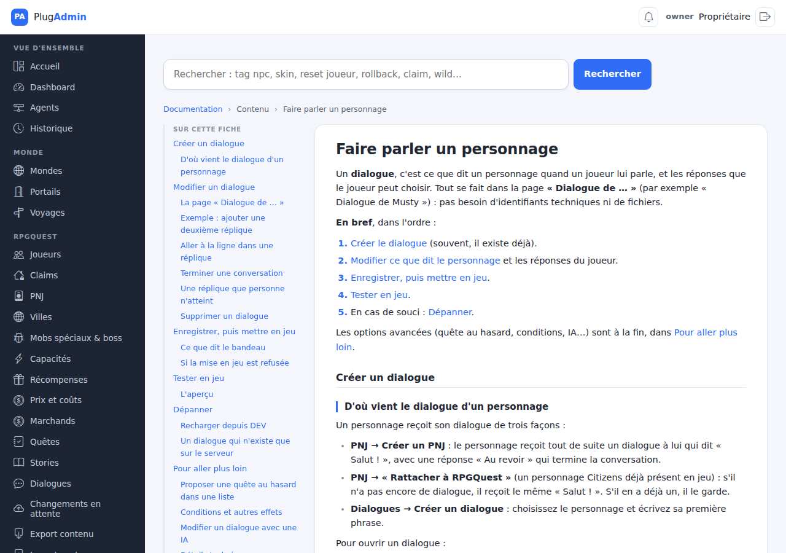 
  - 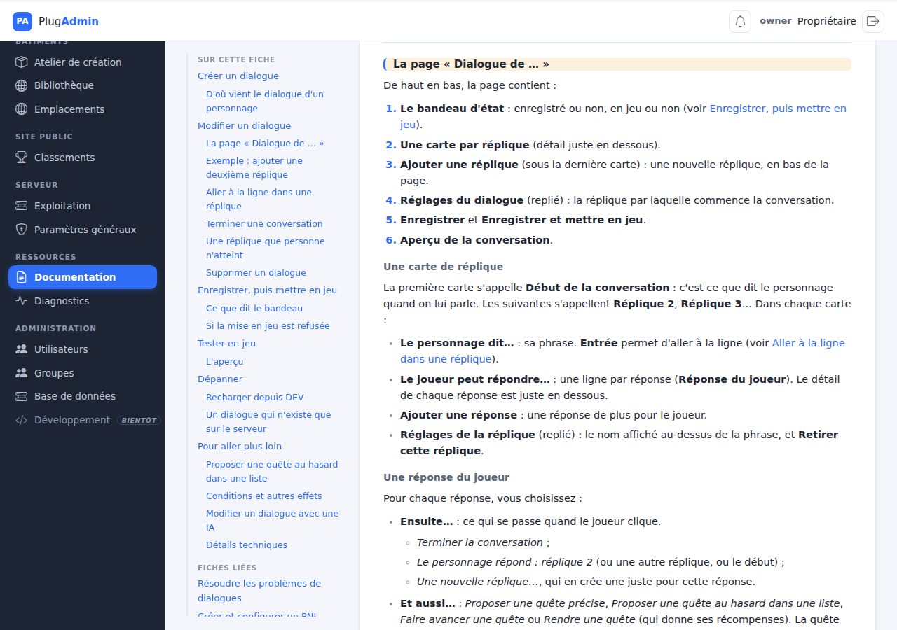 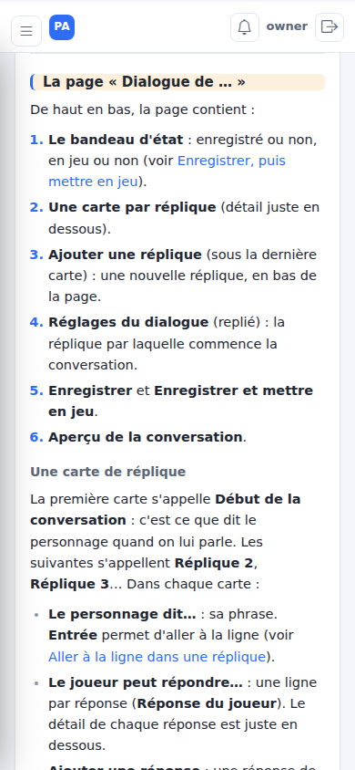
  - 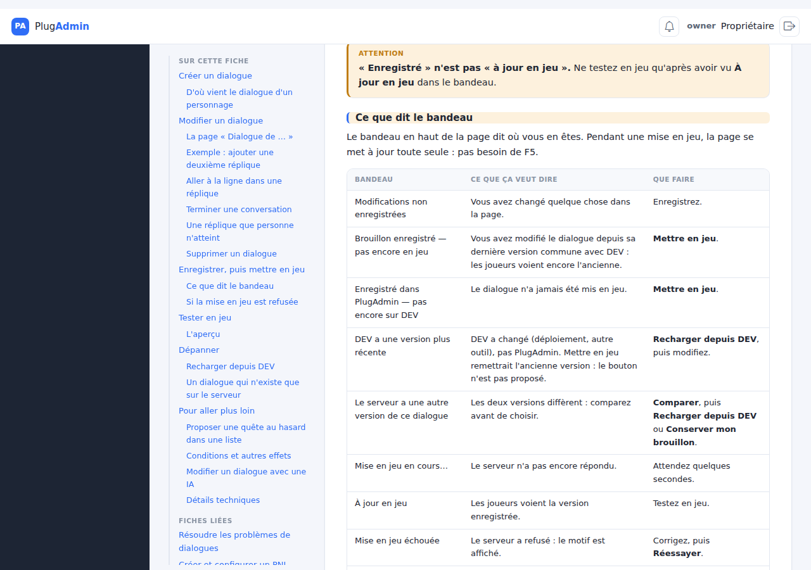 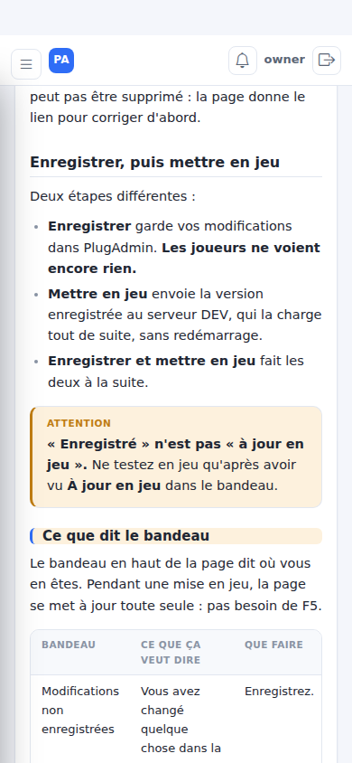
  - 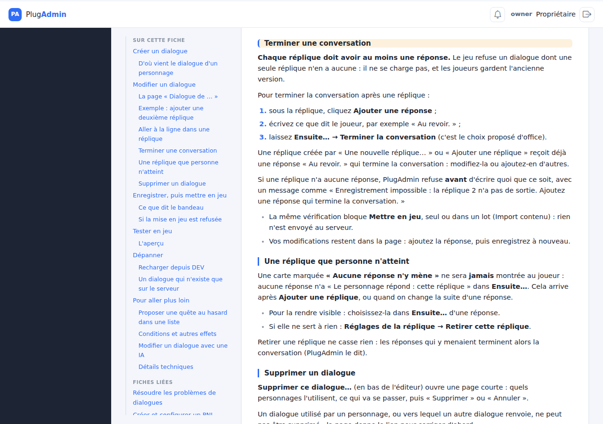 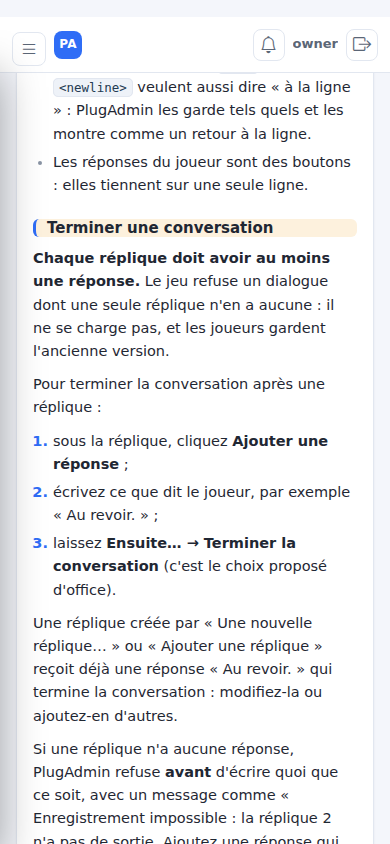
  - 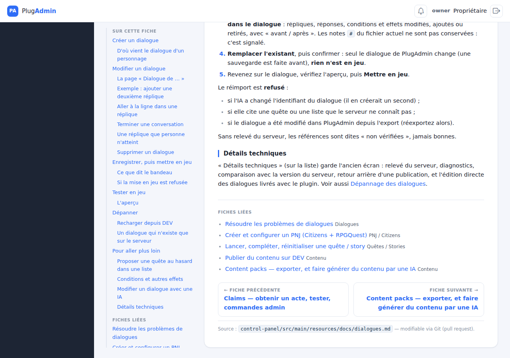 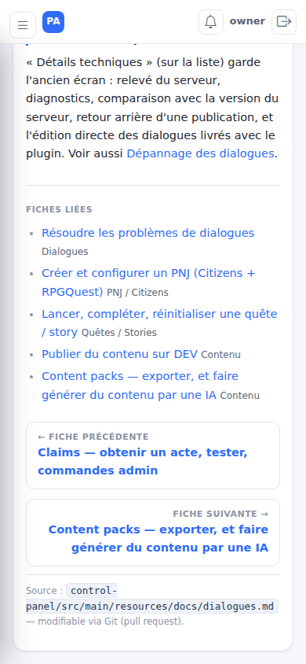
  - 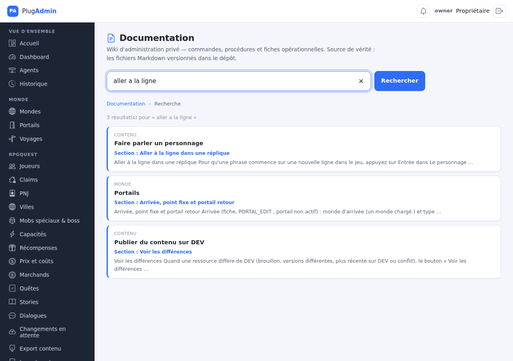 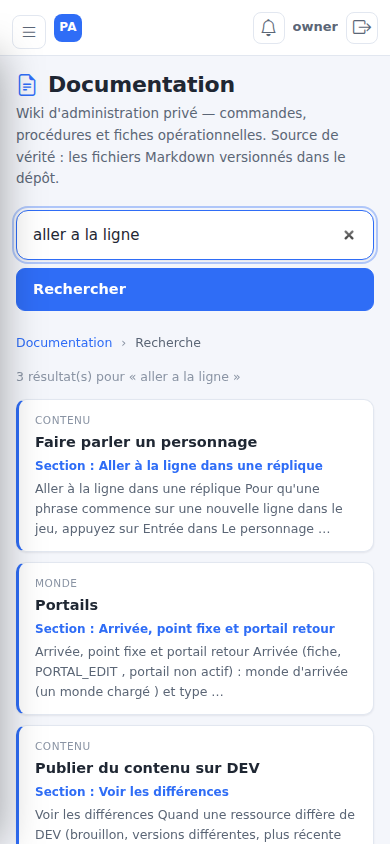

## Tests manuels à effectuer
**TC-426 — PENDING MANUAL VALIDATION** (voir `docs/MANUAL_TEST_PLAN.md`) : validation visuelle par le propriétaire sur ordinateur et téléphone, liens « En savoir plus » / « Comment terminer une conversation ? » depuis l'éditeur, recherche sans accent. La page n'a pas été rouverte connectée sur le PlugAdmin réel (pas de compte jetable créé pour ce lot) : la preuve côté serveur est le JAR déployé (contenu et classes contrôlés) + la route servie.

## Résultat attendu
On trouve une étape sans lire toute la fiche ; plus aucune liste cassée, phrase coupée ou lien déplacé ; les liens des messages d'erreur arrivent sur la bonne section.

## Reset / retour à l'état initial
Rien à réinitialiser (aucune donnée).

## Déploiement VeryGames
Aucun : le JAR Minecraft n'est pas concerné (reste `c42c6bf0`). Pas d'entrée `SERVER_CHANGELOG.md` (aucun impact serveur Minecraft).
**PlugAdmin (AWS)** : `scripts/plugadmin/deploy.sh` depuis `dda731ce` (validation « CI verte sur dda731c ») à 23:03:21 ; le script a affiché `/health KO` 2 s après le redémarrage (course connue), relu 8 s plus tard : `{"panel":"ONLINE"}` ; `/docs/dialogues` → 303 `/login` (route servie) ; JAR `/opt/plugadmin/app/lib/control-panel-0.1.0-SNAPSHOT.jar` contrôlé : `docs/dialogues.md` nouvelle version, CSS `doc-toc-m`, classe `Markdown$Heading`. Pas de redémarrage Minecraft, pas de migration.

## Rollback
`scripts/plugadmin/rollback.sh app` (release précédente `c42c6bf0` conservée sous `/opt/plugadmin/releases/`). Sans effet sur le jeu.

## Logs / diagnostic
`/tmp/s780/deploy.log` (sortie du déploiement) ; `journalctl -u plugadmin`.

## Documentation mise à jour
`docs/control-panel/DOCS_GABARIT.md` (nouveau), `docs/RPGQUEST_BIBLE.md` (gabarit et ancres figées du centre d'aide), `docs/current_state.md`, `docs/MANUAL_TEST_PLAN.md` (TC-426), `docs/SUIVI_VALIDATIONS_DEV.md` (ligne #780 + décision « ancres figées »). `docs-site/` : aucune page ne décrit le centre de documentation PlugAdmin — rien à mettre à jour.

## Limitations / travail restant
- Seule « Faire parler un personnage » a été **réécrite** ; les 27 autres fiches ont été auditées (toutes rendables, reliées, liens vérifiés) mais leur rédaction n'a pas été reprise phrase par phrase pour un lecteur de 13 ans : à faire fiche par fiche si le propriétaire le souhaite.
- Pas de surlignage automatique de la section en cours dans le sommaire (nécessiterait du JS ; non demandé explicitement).
- #780 et #729 restent ouverts (validation visuelle).

## Prochaine étape suggérée
Le propriétaire déroule TC-426 ; selon son retour, reprendre la rédaction des fiches les plus longues (`pnj-depannage`, `dialogues-depannage`, `rpgquest-commandes`) avec le même gabarit.
